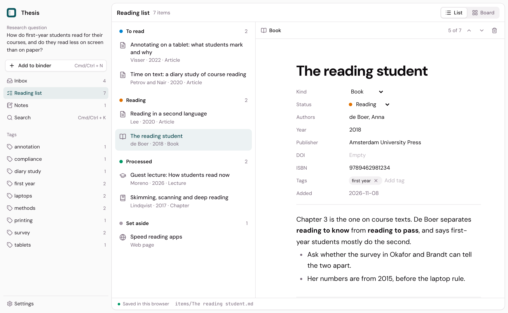

<p align="center">
  
</p>

<h1 align="center">Binder</h1>

<p align="center">
  <strong>Collect, read, understand</strong><br>
  A research binder for the sources of a thesis, a paper or a course.
</p>

<p align="center">
  <a href="https://github.com/dwarsbit/binder-oss/actions/workflows/ci.yml"></a>
  <a href="LICENSE"></a>
  <a href="https://github.com/dwarsbit/binder-oss/releases"></a>
</p>

<p align="center">
  <a href="CHANGELOG.md">Changelog</a> ·
  <a href="docs/guide.md">Guide</a> ·
  <a href="https://github.com/dwarsbit/binder-oss/releases">Releases</a> ·
  <a href="https://github.com/dwarsbit/polemic-oss">Polemic</a> ·
  <a href="https://github.com/dwarsbit/cursive-oss">Cursive</a>
</p>

<p align="center">
  
</p>

Binder keeps the sources of a research project together: articles, books,
web pages, lectures, slides and your own thoughts. You write down your
research question, add what you find, and move each source from your inbox
to your reading list and on, until you know what it means for your
project. Each item has your notes on it, in blocks. A binder is a folder of
Markdown files on your computer, with the original files next to them, so
nothing is locked in.

Binder is for macOS, Windows and Linux, and for the browser with a free
Scholarkit account. It is open source and part of the Polemic kit, with
[Polemic](https://github.com/dwarsbit/polemic-oss) for writing in LaTeX and
[Cursive](https://github.com/dwarsbit/cursive-oss) for notes, presentations
and tutorials.

Binder is in early development. This is version 0.3: collecting,
organizing and reading, with highlights in PDFs and web pages, and an
assistant on your own AI provider or a model on your computer that reads
your sources and sums them up. Asking your sources questions comes in 0.4.

## Features

- **Binders**: make a binder for each project, in the Binder folder in
  your home folder, or open any folder as one. Write down your research
  question when you make it, and change it in the sidebar.
- **Add anything**: press Cmd/Ctrl + N and paste a link, a DOI or an ISBN,
  or write down a thought. A DOI is looked up at Crossref and an ISBN at
  Open Library, so the title, authors, year and journal fill themselves
  in. Add a file, or drop files on the window: each is copied next to its
  item.
- **Zotero**: add a whole collection from the Zotero app or your library
  at zotero.org at once, or search for a work. Works already in the binder
  are left out, and each item opens in Zotero.
- **Inbox**: everything new lands in your inbox. Move each item on to your
  reading list, or set it aside, and the next one opens.
- **Reading list**: five statuses, from inbox to set aside, as a list or
  as a board. Drag a card to another column to change its status.
- **Read and highlight**: read a PDF or a web page next to your notes,
  with zoom and find. Highlight a claim, definition, method, finding or
  quote, and drag it into your notes: it keeps a link to its page. A link
  you add keeps the page's text, so you can read it without the site.
- **Assistant**: on a provider with your own key, or a model on your
  computer. It proposes each new source's details and tags, sums it up for
  your research question, says what to read closely, outlines a long
  source and proposes highlights. Every sentence links to the passage it
  rests on, checked against the source, and nothing changes until you
  accept it or take it over.
- **Notes in blocks**: write on any item, or add a note of your own, with
  the blocks of Cursive: headings, lists, quotes, callouts, tables,
  equations and `@` citations. Link items with `[[`.
- **Tags**: tag items and see every tag with its items in the sidebar.
- **Search**: Cmd/Ctrl + K searches titles, authors, journals, DOIs, tags
  and notes, and the text of every PDF and kept page. Cmd/Ctrl + F finds
  text in the open item or source.
- **Your files**: an item is a Markdown file with its details in the front
  matter, as Cursive and Obsidian read it. See [the binder format](docs/format.md).

## Develop

Binder is a Tauri app: a React front end in `src/` and a Rust back end in
`src-tauri/`. The block editor is the package `@scholarkit/editor` in
`packages/editor`, which Binder shares with Cursive. The same front end
runs in a browser, with its binders on the Scholarkit server.

This repository mirrors Binder's folder in the Scholarkit monorepo, where
it is developed, and is updated with every change there. Pull requests are
welcome here: an accepted one is applied in Scholarkit and comes back with
the next update.

### Requirements

- Node.js 22 or later and pnpm
- Rust (stable) with cargo and the
  [Tauri prerequisites](https://tauri.app/start/prerequisites/)

### Run

```bash
pnpm install
pnpm tauri dev    # the desktop app
pnpm dev          # a demo in the browser, at http://localhost:1440
pnpm dev:web      # the browser app as the server serves it, at /binder/
```

`pnpm dev` keeps a sample binder in the browser's own storage.
`pnpm dev:web` needs the Scholarkit API on this computer (`pnpm dev` in
`apps/api`, or set `BINDER_SERVER`), and you sign in on it first.

### Check

CI runs the same checks on every pull request.

```bash
pnpm lint
pnpm typecheck
pnpm test
pnpm build
cd src-tauri && cargo test
```

### Build

```bash
pnpm tauri build  # the desktop app
pnpm build:web    # the browser app, into dist-web
```

### More

- `packages/editor`: the block editor, shared with
  [Cursive](https://github.com/dwarsbit/cursive-oss)
  ([README](packages/editor/README.md))
- `src/lib/binder.ts`: a binder and its items as Markdown files, with
  their tests
- `src/lib/store.ts`: a binder as a folder on disk, or in the browser for
  the demo
- `src/lib/server-store.ts` and `src/components/Web.tsx`: Binder in the
  browser, with its binders in the Scholarkit account
- `src/components/Desktop.tsx`: the desktop app, which signs in to the
  Scholarkit account and syncs a binder folder with it
  (`packages/editor/src/lib/link-sync.ts`)
- `docker/web`: the image of the browser build, which Scholarkit's
  **Binder web image** workflow pushes to
  `ghcr.io/dwarsbit/scholarkit-binder-web`
- `src/components`: the sidebar, the lists and board, an item, and the
  dialogs
- `src-tauri`: the desktop app, which reads and writes the binder's
  folder, keeps the list of binders, signs in to the Scholarkit account
  (`account.rs`, with the token in the system's credential store) and
  talks to the Zotero app. `BINDER_SERVER` sets another server, such as
  `http://localhost:3000` for a server on this computer.
- [The binder format](docs/format.md): what Binder writes, version by
  version
- [Releasing](docs/releasing.md): how a version is built and published
- [Content style](CONTENT.md): the rules for all public text, from the
  Polemic design system. Change them there first.
- [Interface languages](packages/i18n/README.md): every message goes
  through `t()`; `pnpm i18n` updates the catalogs in `src/locales`

## License

[GPL-3.0](LICENSE)
